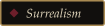

 

 

 

<i>Ars longa, vita brevis.</i>

<h2 align="center">About</h2>

I am drawn to surrealism, classical art, romanticism, dark academia and mythology, and I bring that eye to my code: interfaces built with intention, and a habit of looking for what is hidden in the corners. I build web interfaces and study the security side of systems.

<h2 align="center">Index</h2>

| Section | What it holds |
| :-: | :-: |
| [Scriptorium](#scriptorium) | The projects, with language and focus |
| [Instruments](#instruments) | The tools and languages I work with |
| [Fields of study](#fields-of-study) | Where my attention goes |
| [Where to begin](#where-to-begin) | A suggested reading order |
| [Correspondence](#correspondence) | How to reach me |

<h2 align="center">Scriptorium</h2>

<i>The work, set down in one place.</i>

| Project | Language | Focus |
| :-: | :-: | :-: |
| [Phishing-Dashboard](https://github.com/Cynet04/Phishing-Dashboard) | JavaScript | Dashboard interface for phishing exercises |
| [Facebook-Clone](https://github.com/Cynet04/Facebook-Clone) | JavaScript | Recreating a familiar social interface |
| [Instagram-Clone](https://github.com/Cynet04/Instagram-Clone) | JavaScript | Feed and profile layout |
| [Tiktok-Clone](https://github.com/Cynet04/Tiktok-Clone) | JavaScript | Vertical, scrolling video interface |
| [LinkedIn-Clone](https://github.com/Cynet04/LinkedIn-Clone) | CSS | Professional network layout |
| [My-Windows-Cheat-sheet](https://github.com/s4ntrx/My-Windows-Cheat-sheet) | Documentation | Windows commands for administration, auditing and incident response (a class assignment by s4ntrx) |

<h2 align="center">Instruments</h2>

<i>What the work is made with.</i>

 

| Instrument | Seen in |
| :-: | :-: |
| JavaScript | Phishing-Dashboard, Facebook-Clone, Instagram-Clone, Tiktok-Clone |
| CSS | LinkedIn-Clone and the styling across the interface projects |
| Windows command line | My-Windows-Cheat-sheet |
| Git and pull requests | Collaborative work, recognised by the Pull Shark achievement on this profile |

<h2 align="center">Fields of study</h2>

<i>Three directions, in no strict order.</i>

- **Web interfaces.** Rebuilding well-known products to understand how their layouts, feeds and navigation are put together.
- **Security fundamentals.** System administration, auditing and incident response on Windows.
- **Phishing awareness.** How deceptive pages are structured, and how a dashboard can make that visible.

<h2 align="center">Where to begin</h2>

<i>A path through the repositories, if you are short on time.</i>

1. Open [Phishing-Dashboard](https://github.com/Cynet04/Phishing-Dashboard) to see the most security-oriented work.
2. Read [My-Windows-Cheat-sheet](https://github.com/s4ntrx/My-Windows-Cheat-sheet) for the systems and incident-response side.
3. Browse the clones, starting with [Instagram-Clone](https://github.com/Cynet04/Instagram-Clone), to see how I approach interface layout.

<h2 align="center" id="correspondence">Correspondence</h2>

<i>The door is open.</i>

- Found a bug or a rough edge? Open an issue on the repository concerned.
- Have a fix or an idea? Send a pull request.
- Want to follow along? [Follow this profile](https://github.com/Cynet04) or browse the [stars](https://github.com/Cynet04?tab=stars).

 

<i>Per aspera ad astra.</i>

